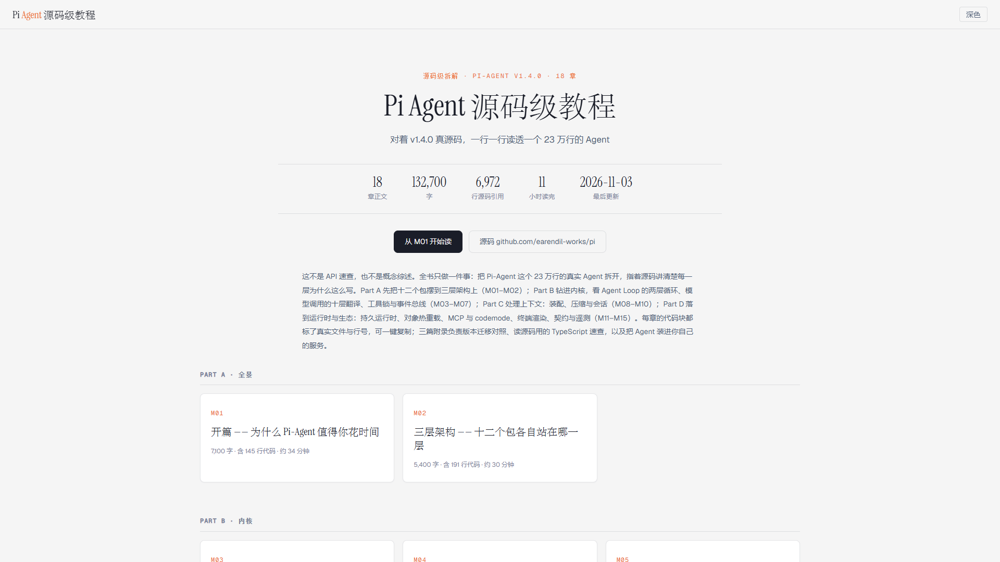
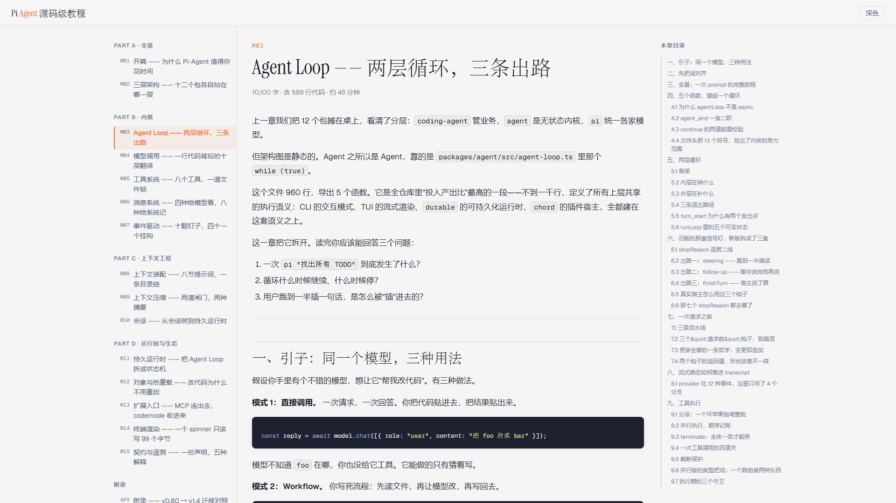

<div align="center">

# Pi Agent 源码级教程

**对着 v1.4.0 真源码，一行一行读透一个 23 万行的 Agent**

<sub>18 章 · 132,700 字 · 6,972 行源码引用 · 约 11 小时读完</sub>

<br>

[](https://daniel-csvw.github.io/pi-agent-book/)

[](https://daniel-csvw.github.io/pi-agent-book/)
[](https://daniel-csvw.github.io/pi-agent-book/)
[](https://daniel-csvw.github.io/pi-agent-book/)
[](https://github.com/earendil-works/pi)

**[马上开始读 →](https://daniel-csvw.github.io/pi-agent-book/)**

</div>

<p align="center">
  
</p>

---

## 这是什么

市面上讲 Agent 的文章，大多停在"调一次 API、跑一个 demo"。但真到了要改一个能上线的 Agent，你会卡在别的地方：

- 为什么工具调用要做文件锁？并发写同一个文件到底会怎样？
- 上下文超了之后，是先截断还是先摘要？摘要对象是谁？
- 流式输出中途用户断连，服务端怎么知道该停？
- 会话持久化到磁盘以后，凭什么叫"可以重放"？

这套教程只做一件事：**把 Pi-Agent 这个 23 万行的真实 Agent 拆开，指着源码讲清楚每一层为什么这么写。**每一处结论都对得上 v1.4.0 的真实文件与行号，每一段代码都能一键复制去验证。

不是 API 速查，不是概念综述，是一份可以照着复现的阅读笔记。

<div align="center">

### [daniel-csvw.github.io/pi-agent-book](https://daniel-csvw.github.io/pi-agent-book/)

</div>

---

## 你会读到什么

| 主题 | 你会拿到的答案 |
| --- | --- |
| Agent Loop | 两层循环、三条出路：模型调用为什么必须包在工具执行里 |
| 模型调用 | 一行 `prompt()` 背后的十层翻译，provider 差异在哪被抹平 |
| 工具系统 | 八个内置工具、一道文件锁，权限与沙箱的边界画在哪 |
| 消息系统 | 四种消息给模型看，八种给系统记，投影规则是什么 |
| 事件驱动 | 十颗钉子、四十一个挂钩，扩展先于 UI 是硬契约 |
| 上下文工程 | 八节提示词怎么装配，目录链怎么拼 |
| 上下文压缩 | 两道闸门、两种摘要，压缩之后谁被改写 |
| 会话 | 从会话树到持久运行时，写盘、重放、投影 |
| 持久运行时 | 把一个 while 循环拆成可恢复的状态机 |
| 对象与热重载 | 改代码为什么不用重启 |
| 扩展入口 | MCP 怎么连出去，codemode 怎么收进来 |
| 终端渲染 | 一个 spinner 只该写 99 个字节，是怎么算出来的 |
| 契约与遥测 | 一份声明，五种解释，schema 与 telemetry 的配合 |

---

## 章节目录

全部可在线读，点标题直接跳转。

### Part A · 全景

| # | 章节 | 篇幅 |
| --- | --- | --- |
| M01 | [开篇 —— 为什么 Pi-Agent 值得你花时间](https://daniel-csvw.github.io/pi-agent-book/modules/m01-overview.html) | 7,100 字 · 145 行 |
| M02 | [三层架构 —— 十二个包各自站在哪一层](https://daniel-csvw.github.io/pi-agent-book/modules/m02-package-map.html) | 5,400 字 · 191 行 |

### Part B · 内核

| # | 章节 | 篇幅 |
| --- | --- | --- |
| M03 | [Agent Loop —— 两层循环，三条出路](https://daniel-csvw.github.io/pi-agent-book/modules/m03-agent-loop.html) | 10,100 字 · 589 行 |
| M04 | [模型调用 —— 一行代码背后的十层翻译](https://daniel-csvw.github.io/pi-agent-book/modules/m04-model-call.html) | 8,200 字 · 463 行 |
| M05 | [工具系统 —— 八个工具，一道文件锁](https://daniel-csvw.github.io/pi-agent-book/modules/m05-tools.html) | 6,200 字 · 218 行 |
| M06 | [消息系统 —— 四种给模型看，八种给系统记](https://daniel-csvw.github.io/pi-agent-book/modules/m06-messages.html) | 6,200 字 · 166 行 |
| M07 | [事件驱动 —— 十颗钉子，四十一个挂钩](https://daniel-csvw.github.io/pi-agent-book/modules/m07-event-driven.html) | 6,300 字 · 283 行 |

### Part C · 上下文工程

| # | 章节 | 篇幅 |
| --- | --- | --- |
| M08 | [上下文装配 —— 八节提示词，一条目录链](https://daniel-csvw.github.io/pi-agent-book/modules/m08-context.html) | 8,400 字 · 533 行 |
| M09 | [上下文压缩 —— 两道闸门，两种摘要](https://daniel-csvw.github.io/pi-agent-book/modules/m09-compaction.html) | 10,100 字 · 1,062 行 |
| M10 | [会话 —— 从会话树到持久运行时](https://daniel-csvw.github.io/pi-agent-book/modules/m10-session.html) | 10,700 字 · 495 行 |

### Part D · 运行时与生态

| # | 章节 | 篇幅 |
| --- | --- | --- |
| M11 | [持久运行时 —— 把 Agent Loop 拆成状态机](https://daniel-csvw.github.io/pi-agent-book/modules/m11-durable.html) | 9,300 字 · 364 行 |
| M12 | [对象与热重载 —— 改代码为什么不用重启](https://daniel-csvw.github.io/pi-agent-book/modules/m12-chord.html) | 9,000 字 · 329 行 |
| M13 | [扩展入口 —— MCP 连出去，codemode 收进来](https://daniel-csvw.github.io/pi-agent-book/modules/m13-mcp-codemode.html) | 10,000 字 · 944 行 |
| M14 | [终端渲染 —— 一个 spinner 只该写 99 个字节](https://daniel-csvw.github.io/pi-agent-book/modules/m14-tui.html) | 8,300 字 · 299 行 |
| M15 | [契约与遥测 —— 一份声明，五种解释](https://daniel-csvw.github.io/pi-agent-book/modules/m15-schema-telemetry.html) | 9,700 字 · 518 行 |

### 附录

| # | 章节 | 篇幅 |
| --- | --- | --- |
| APX-1 | [附录 A —— v0.80 → v1.4 迁移对照](https://daniel-csvw.github.io/pi-agent-book/modules/appendix-migration.html) | 3,200 字 · 73 行 |
| APX-2 | [附录 B —— 读源码用的 TypeScript 速查](https://daniel-csvw.github.io/pi-agent-book/modules/appendix-typescript.html) | 1,600 字 · 80 行 |
| APX-3 | [附录 C —— 把 Agent 装进你的服务](https://daniel-csvw.github.io/pi-agent-book/modules/appendix-service.html) | 2,900 字 · 220 行 |

---

## 三条阅读路线

| 你有多少时间 | 怎么读 |
| --- | --- |
| 30 分钟 | M01 → M03。先看它凭什么算一个 Agent，再看主循环怎么转 |
| 半天 | Part A + Part B（M01–M07）。吃透内核，够你改一个自己的 Agent |
| 全流程 | M01 → M15。最后用附录 C 把它装成一个 HTTP 服务 |


---

## 这个站点本身

纯静态，无框架、无运行时依赖、无构建服务器：

- **零依赖渲染**：一个 `build.mjs` 把 Markdown 编译成自包含 HTML，字体走 Google Fonts，离线时自动降级系统字体
- **语法高亮**：自带单遍词法器，6 种 token 配色，行号可钉住（```` ```ts {3,5-7} ````）
- **一键复制**：每个代码块都能整块复制，`file://` 下也有 `execCommand` 退路
- **长文友好**：顶部阅读进度条、右侧本章目录（滚动高亮）、上一章/下一章
- **深色模式**：跟随 `localStorage` 记忆，刷新不闪
- **窄屏不破版**：宽表格、长代码行各在自己的滚动容器里，整页永不横向漂移

| 章节页：左侧导航 / 中间正文 / 右侧本章目录 | 深色模式 |
| --- | --- |
|  |  |

本仓库是**构建产物**（`index.html` + `modules/*.html` + `styles.css`），只用于 GitHub Pages 托管。内容源与生成脚本在源工程里，改文章请改 Markdown 后重新构建，不要直接编辑这里的 HTML。

本地预览（可选）：

```bash
git clone https://github.com/Daniel-csvw/pi-agent-book.git
cd pi-agent-book
python -m http.server 8000
# 打开 http://localhost:8000
```

---

## 版本与范围

- 阅读对象：**Pi-Agent v1.4.0**（[earendil-works/pi](https://github.com/earendil-works/pi)），约 23 万行
- 覆盖范围内核 12 个包与主要运行时路径；未覆盖的部分会在章节里注明"这里没展开"
- 源码版本变动后，行号可能漂移，结论以文中标注的 tag 为准
- 内容为个人学习笔记，源码与设计版权归原作者；文中引用仅用于教学

---

## 作者

**Daniel** · 上汽大众有限公司 · 一名码农

邮件：[luhui215@hotmail.com](mailto:luhui215@hotmail.com)
站点：<https://daniel-csvw.github.io/pi-agent-book/>

## 致谢

- [earendil-works/pi](https://github.com/earendil-works/pi) —— 全书读的就是它，所有代码片段、行号与设计思路都来自 v1.4.0 源码本身
- [dg-ai-notes](https://dg-ai-notes.pages.dev/) —— 双轨教程的内容组织与站点版式参考，本站的配色、字号梯度与阅读宽度直接复刻自它
- 也感谢每一位把踩坑过程成文的人：本站很多结论最初都来自别人零散的 issue 与技术笔记

<div align="center">
<sub>如果这套笔记帮你少踩了一个坑，点个 Star 就是最好的反馈。</sub>
</div>
